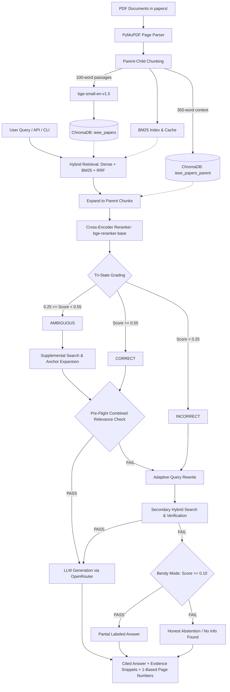

# CiteFirst RAG-pipeline — Python Corrective RAG Backend

A citation-grounded corrective Retrieval-Augmented Generation (CRAG) backend in Python. CiteFirst ingests academic and technical PDFs, decomposes them into page-aware parent and child chunks, runs dense and sparse hybrid retrieval with Reciprocal Rank Fusion (RRF), cross-encoder reranking, tri-state relevance grading, ambiguous evidence rescue, query rewriting, pre-flight combined relevance verification, and OpenRouter-backed cited answer generation.

This repository is a **standalone, backend-only** service providing both a FastAPI HTTP/SSE server with Swagger UI and standalone CLI entry points.

---

## System Architecture



### Key Components

1. **Page-Aware Ingestion & Numbering**: Extracts text from PDFs using PyMuPDF while recording zero-based internal page indices (`page_index`). Displays one-based physical page numbers (`page_number = page_index + 1`) across all evidence snippets, citations, and API outputs.
2. **Hierarchical Parent-Child Chunking**:
   - **Parent Chunks**: ~300–350 words, capturing surrounding narrative context without truncation.
   - **Child Chunks**: ~100 words, embedded via `BAAI/bge-small-en-v1.5` for high-precision vector search.
3. **Dense + Sparse Hybrid Search**: Combines cosine distance from ChromaDB with BM25 Okapi term scores using Reciprocal Rank Fusion (RRF).
4. **Tri-State Relevance Grading**: `BAAI/bge-reranker-base` cross-encoder grades retrieved chunks into `CORRECT` (>= 0.55), `AMBIGUOUS` (0.25–0.55), or `INCORRECT` (< 0.25).
5. **Pre-Flight Combined Relevance Verification**: Checks candidate passages collectively before passing to the generator, preventing false-positive hallucinations.
6. **Adaptive Fallback & Query Rewrite**: Rewrites ambiguous queries and executes secondary search passes before falling back to bendy mode (partial matches) or honest abstention.
7. **Safe Upload & Deletion**: PDF uploads reject duplicate filenames with HTTP 409 Conflict to protect existing documents and indices from destructive overwrite. To replace a document, delete it first via `DELETE /api/vault/delete/{filename}` and re-upload. Partial index writes on failed new uploads roll back cleanly, and physical files are preserved if index deletion fails.

---

## Quickstart (Windows PowerShell)

### 1. Prerequisites
- **Python**: Python 3.12+ (tested on Python 3.14 on Windows 64-bit).
- **PowerShell**: Windows PowerShell 5.1 or PowerShell 7+.

### 2. Environment Setup

Open PowerShell and navigate to the project directory:

```powershell
Set-Location 'C:\PROJECTS\CiteFirst RAG-pipeline'
```

Create and activate a virtual environment:

```powershell
py -3.12 -m venv .venv
.\.venv\Scripts\Activate.ps1
```

Install production and test dependencies:

```powershell
python -m pip install -r requirements.txt
python -m pip install -r requirements-test.txt
```

### 3. Configure Credentials

Copy `.env.example` to `.env`:

```powershell
Copy-Item .env.example .env
```

Edit `.env` to supply your OpenRouter API key:

```ini
OPENROUTER_API_KEY=sk-or-v1-your-actual-api-key
OPENROUTER_MODEL=meta-llama/llama-3.3-70b-instruct
OPENROUTER_BASE_URL=https://openrouter.ai/api/v1
CITEFIRST_VECTOR_DIR=./vector_vault
```

> **Note**: An OpenRouter key is required only for live generation (`POST /api/query`, `/api/query/stream`, or direct CLI answer generation). Offline tests and retrieval evaluation run model-free without an API key.

---

## Running the Backend

### Run the FastAPI Server

```powershell
python -m uvicorn api:app --host 127.0.0.1 --port 8000
```

- **Interactive Swagger Documentation**: [http://127.0.0.1:8000/docs](http://127.0.0.1:8000/docs)
- **OpenAPI Schema**: [http://127.0.0.1:8000/openapi.json](http://127.0.0.1:8000/openapi.json)
- **Health Check**: [http://127.0.0.1:8000/api/health](http://127.0.0.1:8000/api/health)

### Direct CLI Ingestion

Place your PDF files into the `papers/` folder, then run batch ingestion directly:

```powershell
python database.py
```

Or upload papers via HTTP using `upload_papers.py`:

```powershell
python upload_papers.py
```

### Direct CLI Query

Execute queries directly against the vault without starting the HTTP server:

```powershell
python logic_engine.py "What is the criterion for turbulent flow?"
```

---

## API Endpoints Reference

| Method | Endpoint | Description |
|---|---|---|
| `GET` | `/api/health` | Health & pipeline readiness (`status: "ok"` or `"degraded"`). |
| `POST` | `/api/query` | Synchronous RAG query. Returns answer, facts, citations, and evidence. Returns `503` if pipeline dependencies are unavailable. |
| `POST` | `/api/query/stream` | Server-Sent Events (SSE) stream reporting real stage progress (`fetching`, `reranking`, `resolving`, `generating`, `done`). Returns `503` if pipeline dependencies are unavailable. |
| `POST` | `/api/vault/upload` | Upload a PDF. Rejects duplicate filenames with HTTP 409 Conflict to protect existing documents. Cleans up physical file on indexing failure. |
| `GET` | `/api/vault/list` | List all indexed and available vault papers. |
| `GET` | `/api/vault/document/{filename}` | Download or view an ingested PDF document. |
| `DELETE` | `/api/vault/delete/{filename}` | Remove a PDF from ChromaDB collections, BM25 cache, and disk. Protects physical file if index delete fails. |
| `GET` | `/api/settings` | Retrieve active pipeline thresholds and limits. |
| `POST` | `/api/settings` | Dynamically update pipeline hyperparameters. |
| `POST` | `/api/evaluate` | Start an asynchronous evaluation task against `reviewed_dataset.json`. |
| `GET` | `/api/evaluate/{task_id}` | Poll evaluation task status and view results. |

---

## Configuration (`settings.json`)

Pipeline hyperparameters are loaded from `settings.json` with fallback defaults in `settings_config.py`:

```json
{
  "FETCH_K": 30,
  "PROCESS_K": 10,
  "CHUNK_WORD_LIMIT": 300,
  "CORRECT_THRESHOLD": 0.55,
  "AMBIGUOUS_THRESHOLD": 0.25,
  "BENDY_THRESHOLD": 0.10,
  "MAX_VERIFIED_CHUNKS": 2,
  "SOFTMAX_MASS_CUTOFF": 0.90,
  "DISTANCE_THRESHOLD": 0.70,
  "TOTAL_DOCS": 60
}
```

- `FETCH_K`: Candidate chunk count fetched from vector & sparse search.
- `PROCESS_K`: Top passages evaluated by the cross-encoder reranker.
- `CORRECT_THRESHOLD`: Cross-encoder score above which a passage is deemed relevant.
- `AMBIGUOUS_THRESHOLD`: Passages between this threshold and `CORRECT_THRESHOLD` trigger ambiguous rescue.
- `BENDY_THRESHOLD`: Minimum relevance score for partial matches when all primary searches fail.
- `MAX_VERIFIED_CHUNKS`: Maximum facts passed into final LLM synthesis to prevent distraction.

---

## Offline Testing vs. Live Validation

### 1. Offline Regression Suite (Model-Free)
The test suite in `tests/` verifies API routing, HTTP status codes, security boundaries, error propagation, path traversal defense, and deterministic retrieval logic without downloading models or calling external APIs:

```powershell
python -m pytest -q tests
```

- **104 passing tests**, 3 skipped (requiring elevated symlink permissions on Windows).
- Fast execution (~20 seconds).
- Validates failure modes: pipeline down returns honest `503 Service Unavailable`, not false `200 [STUB]`.

### 2. Bytecode Verification
```powershell
python -m compileall -q api.py database.py logic_engine.py providers.py settings_config.py evaluator.py phase4_diagnostics.py upload_papers.py evaluation scripts tests
```

### 3. Live Pipeline Smoke Test
Ingests a real multi-page PDF, computes embeddings with SentenceTransformers, stores chunks in ChromaDB, queries through hybrid retrieval, reranks with cross-encoder, and generates cited answers with OpenRouter:

```powershell
python logic_engine.py "Sample test query"
```

---

## Evaluation Dataset & Historical Benchmarks

The project includes `reviewed_dataset.json`, a human-verified dataset of 18 questions across technical domains.

To run audit-only verification:

```powershell
python evaluator.py --audit-only
```

### Evaluation & Benchmark Distinctions
- **Dataset Audit Only**: The checked-in `reviewed_dataset.json` has 18 records and is useful for an **audit-only** check; the evaluation methodology reports **zero records eligible for a scored default run**. Do not call its audit a reproduced retrieval benchmark.
- **Historical Corpus Absence**: The historical 66-paper, 7,816-chunk corpus/index is not included in Git; do not claim to reproduce its metrics without the same corpus and protocol.
- **Classification vs. Final Answer Quality**: Historical 98.48% chunk classification is not final-answer accuracy. In historical human review on the development corpus:
  - 2 of 22 development questions were accepted.
  - 4 of 4 pilot questions were accepted, but were disclosed during pipeline tuning (not a blind independent validation).
- **Smoke Testing Scope**: The synthetic two-page PDF smoke test establishes an operational pipeline path (parsing, embedding, retrieval, reranking, and generation/abstention), not general research-answer quality. The full historical 26-question evaluation was not rerun without the original corpus.

---

## Troubleshooting

- **Cold Start Delay**: The first query after startup downloads or initializes `bge-small-en-v1.5` and `bge-reranker-base` into memory. Subsequent queries execute significantly faster.
- **Missing OpenRouter Key**: If generation fails with `EnvironmentError: OPENROUTER_API_KEY not found`, ensure your key is set in `.env` or process environment.
- **Windows Paths with Spaces**: Project paths use `Path(__file__).resolve().parent` anchoring, safely handling spaces and non-standard drive roots. Always quote paths when passing CLI arguments in PowerShell.

---

## License & Attribution

See `NOTICE.md` for historical CRAG-Pipeline co-author attribution and usage permissions.
